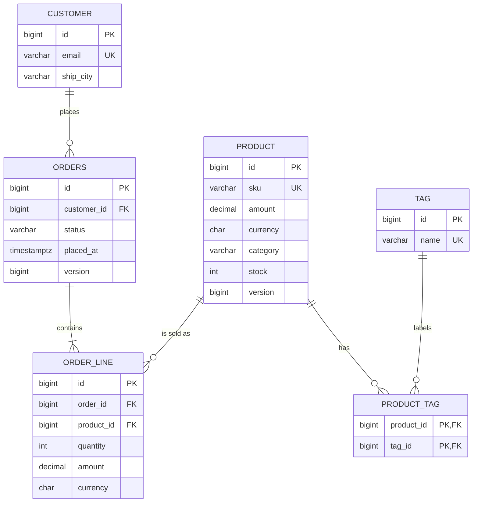

# Lab-03 Challenge – reporting and bulk module (all files in one document)

Contributes only the challenge part. Nothing from Tasks 1-5 is modified except the 3 small additions in section 1.
Packages follow the lab spec (`edu.itc.shop`). Each section below is one file: create it at the given path.

---


## 1. Changes to existing project files (do these first)

1. **pom.xml** – generated static metamodel (`Product_`, `Money_`, `Tag_`):
   ```xml
   <dependency>
     <groupId>org.hibernate.orm</groupId>
     <artifactId>hibernate-processor</artifactId>
     <scope>provided</scope>
   </dependency>
   ```
   Then `./mvnw clean compile` and check `target/generated-sources/annotations/.../Product_.java` exists.
   (If IntelliJ doesn't see it: Settings > Build > Compiler > Annotation Processors > enable.)

2. **Product.java** – add for the optimistic variant (new column comes from `V3__product_version.sql`):
   ```java
   @Version
   private long version;
   public long getVersion() { return version; }
   ```
   Also make sure `Product` has `setStock(int)`, `getStock()`, `getPrice()` and `Tag` has a `name` field.

3. **ProductRepository.java** – plug in the custom fragment:
   ```java
   public interface ProductRepository extends JpaRepository<Product, Long>,
           JpaSpecificationExecutor<Product>, ProductReportRepositoryCustom { ... }
   ```
4. Copy the files from `src/` into your project (same packages), commit, `git tag challenge`.
5. Do NOT edit V1/V2 (-10 points). V3 is a new migration.

---
## 2. New files

### `src/main/java/edu/itc/shop/repository/OrderFeedRepository.java`

```java
package edu.itc.shop.repository;

import org.springframework.data.domain.*;
import org.springframework.data.jpa.repository.EntityGraph;
import org.springframework.data.jpa.repository.JpaRepository;
import edu.itc.shop.domain.Order;

/** Separate interface so you don't have to touch OrderRepository. */
public interface OrderFeedRepository extends JpaRepository<Order, Long> {

    /** Offset-based: select ... order by placed_at desc, id desc offset ? rows fetch first ? rows only */
    @EntityGraph(attributePaths = "customer")
    Slice<Order> findSliceBy(Pageable pageable);

    /** Keyset: select ... where (placed_at < ? or (placed_at = ? and id < ?)) order by ... fetch first ? rows only */
    @EntityGraph(attributePaths = "customer")
    Window<Order> findAllByOrderByPlacedAtDescIdDesc(ScrollPosition position, Limit limit);
}
```

### `src/main/java/edu/itc/shop/repository/ProductReportFilter.java`

```java
package edu.itc.shop.repository;

import java.math.BigDecimal;
import edu.itc.shop.domain.Category;

public record ProductReportFilter(String q, Category category, BigDecimal maxPrice, Integer minStock, String tag) { }
```

### `src/main/java/edu/itc/shop/repository/ProductReportRepositoryCustom.java`

```java
package edu.itc.shop.repository;

import java.util.List;
import edu.itc.shop.web.dto.ProductReportRow;

public interface ProductReportRepositoryCustom {
    List<ProductReportRow> report(ProductReportFilter filter, String sort);
}
```

### `src/main/java/edu/itc/shop/repository/ProductReportRepositoryImpl.java`

```java
package edu.itc.shop.repository;

import java.math.BigDecimal;
import java.util.*;
import jakarta.persistence.EntityManager;
import jakarta.persistence.PersistenceContext;
import jakarta.persistence.criteria.*;
import edu.itc.shop.domain.Money;
import edu.itc.shop.domain.Money_;
import edu.itc.shop.domain.Product;
import edu.itc.shop.domain.Product_;
import edu.itc.shop.domain.Tag;
import edu.itc.shop.domain.Tag_;
import edu.itc.shop.web.dto.ProductReportRow;

/** Custom fragment: Spring Data picks it up because the class name is <FragmentInterface>Impl. */
public class ProductReportRepositoryImpl implements ProductReportRepositoryCustom {

    @PersistenceContext
    private EntityManager em;

    @Override
    public List<ProductReportRow> report(ProductReportFilter f, String sort) {
        CriteriaBuilder cb = em.getCriteriaBuilder();
        CriteriaQuery<ProductReportRow> cq = cb.createQuery(ProductReportRow.class);
        Root<Product> p = cq.from(Product.class);

        Expression<String> sku = p.get(Product_.sku);
        Expression<String> name = p.get(Product_.name);
        Expression<BigDecimal> amount = p.get(Product_.price).get(Money_.amount);
        Expression<Integer> stock = p.get(Product_.stock);
        Expression<Integer> tagCount = cb.size(p.get(Product_.tags));

        // ---- dynamic predicates -------------------------------------------------
        List<Predicate> where = new ArrayList<>();
        if (f.q() != null && !f.q().isBlank())
            where.add(cb.like(cb.lower(name), "%" + f.q().toLowerCase() + "%"));
        if (f.category() != null)
            where.add(cb.equal(p.get(Product_.category), f.category()));
        if (f.maxPrice() != null)
            where.add(cb.lessThanOrEqualTo(amount, f.maxPrice()));
        if (f.minStock() != null)
            where.add(cb.greaterThanOrEqualTo(stock, f.minStock()));
        if (f.tag() != null && !f.tag().isBlank()) {          // join ONLY when needed
            SetJoin<Product, Tag> t = p.join(Product_.tags);
            where.add(cb.equal(t.get(Tag_.name), f.tag()));
        }

        cq.select(cb.construct(ProductReportRow.class, sku, name, amount, stock, tagCount))
          .where(where.toArray(Predicate[]::new))
          .orderBy(order(cb, sort, Map.of(
                  "sku", sku, "name", name, "amount", amount, "stock", stock, "tagCount", tagCount)),
                  cb.asc(p.get(Product_.id)));              // stable tie-break

        return em.createQuery(cq).setMaxResults(500).getResultList();
    }

    /** Whitelist: only keys of the map can be sorted on; anything else -> IllegalArgumentException. */
    private static jakarta.persistence.criteria.Order order(CriteriaBuilder cb, String sort, Map<String, Expression<?>> allowed) {
        String[] parts = (sort == null || sort.isBlank() ? "sku,asc" : sort).split(",");
        Expression<?> expr = allowed.get(parts[0].trim());
        if (expr == null) throw new IllegalArgumentException("Cannot sort by '" + parts[0] + "'");
        boolean desc = parts.length > 1 && parts[1].trim().equalsIgnoreCase("desc");
        return desc ? cb.desc(expr) : cb.asc(expr);
    }
}
```

### `src/main/java/edu/itc/shop/repository/ProductStockRepository.java`

```java
package edu.itc.shop.repository;

import java.util.Optional;
import org.springframework.data.jpa.repository.*;
import org.springframework.data.repository.query.Param;
import edu.itc.shop.domain.Product;
import jakarta.persistence.LockModeType;

public interface ProductStockRepository extends JpaRepository<Product, Long> {

    /** select ... from product where id=? for update */
    @Lock(LockModeType.PESSIMISTIC_WRITE)
    @Query("select p from Product p where p.id = :id")
    Optional<Product> findForUpdate(@Param("id") Long id);

    /** update product set amount... : single atomic statement, 0 rows = not enough stock */
    @Modifying(clearAutomatically = true, flushAutomatically = true)
    @Query("update Product p set p.stock = p.stock - :qty where p.id = :id and p.stock >= :qty")
    int decrementIfAvailable(@Param("id") Long id, @Param("qty") int qty);
}
```

### `src/main/java/edu/itc/shop/service/BulkImportService.java`

```java
package edu.itc.shop.service;

import java.io.IOException;
import java.math.BigDecimal;
import java.nio.file.*;
import java.util.*;
import java.util.stream.Stream;
import jakarta.persistence.EntityManager;
import jakarta.persistence.EntityManagerFactory;
import jakarta.persistence.PersistenceContext;
import org.hibernate.SessionFactory;
import org.hibernate.StatelessSession;
import org.hibernate.Transaction;
import org.springframework.stereotype.Service;
import org.springframework.transaction.annotation.Transactional;
import edu.itc.shop.domain.*;
import edu.itc.shop.repository.ProductRepository;

@Service
public class BulkImportService {
    private static final int CHUNK = 500;
    private final SessionFactory sessionFactory;
    private final ProductRepository products;

    @PersistenceContext private EntityManager em;

    public BulkImportService(EntityManagerFactory emf, ProductRepository products) {
        this.sessionFactory = emf.unwrap(SessionFactory.class);
        this.products = products;
    }

    /** Strategy 1: StatelessSession, no persistence context, no dirty checking, JDBC batches of 500. */
    public int importCsv(Path csv) throws IOException {
        int imported = 0;
        try (StatelessSession ss = sessionFactory.openStatelessSession();
             Stream<String> lines = Files.lines(csv).skip(1)) {
            Transaction tx = ss.beginTransaction();
            ss.setJdbcBatchSize(CHUNK);
            List<Product> chunk = new ArrayList<>(CHUNK);
            for (Iterator<String> it = lines.iterator(); it.hasNext(); ) {
                chunk.add(parse(it.next()));
                if (chunk.size() == CHUNK) { ss.insertMultiple(chunk); imported += chunk.size(); chunk.clear(); }
            }
            if (!chunk.isEmpty()) { ss.insertMultiple(chunk); imported += chunk.size(); }
            tx.commit();
        }
        return imported;
    }

    /** Strategy 2: saveAll in ONE transaction, everything stays in the persistence context (heap grows). */
    @Transactional
    public int importWithSaveAll(Path csv) throws IOException {
        List<Product> all = new ArrayList<>();
        try (Stream<String> lines = Files.lines(csv).skip(1)) { lines.map(BulkImportService::parse).forEach(all::add); }
        return products.saveAll(all).size();
    }

    /** Strategy 3: saveAll per chunk + flush()/clear() every 500 keeps the persistence context small. */
    @Transactional
    public int importWithFlushClear(Path csv) throws IOException {
        int imported = 0;
        List<Product> chunk = new ArrayList<>(CHUNK);
        try (Stream<String> lines = Files.lines(csv).skip(1)) {
            for (Iterator<String> it = lines.iterator(); it.hasNext(); ) {
                chunk.add(parse(it.next()));
                if (chunk.size() == CHUNK) { imported += flushChunk(chunk); }
            }
        }
        if (!chunk.isEmpty()) imported += flushChunk(chunk);
        return imported;
    }

    private int flushChunk(List<Product> chunk) {
        int n = chunk.size();
        products.saveAll(chunk);
        em.flush();
        em.clear();
        chunk.clear();
        return n;
    }

    /** CSV line: sku;name;amount;currency;category;stock */
    static Product parse(String line) {
        String[] c = line.split(";");
        Product p = new Product(c[0], c[1], new Money(new BigDecimal(c[2]), c[3]), Category.valueOf(c[4]));
        p.setStock(Integer.parseInt(c[5]));
        return p;
    }
}
```

### `src/main/java/edu/itc/shop/service/OrderFeedService.java`

```java
package edu.itc.shop.service;

import java.time.Instant;
import java.util.*;
import org.springframework.data.domain.*;
import org.springframework.stereotype.Service;
import org.springframework.transaction.annotation.Transactional;
import edu.itc.shop.domain.Order;
import edu.itc.shop.repository.OrderFeedRepository;
import edu.itc.shop.web.dto.*;

@Service
@Transactional(readOnly = true)
public class OrderFeedService {
    private final OrderFeedRepository repo;
    public OrderFeedService(OrderFeedRepository repo) { this.repo = repo; }

    /** Variant 1: Slice (page number -> OFFSET). Simple, but cost grows with the offset. */
    public FeedPage slice(int page, int size) {
        Slice<Order> s = repo.findSliceBy(PageRequest.of(page, size, Sort.by(Sort.Direction.DESC, "placedAt", "id")));
        List<FeedItem> items = s.getContent().stream().map(OrderFeedService::toItem).toList();
        return new FeedPage(items, s.hasNext() ? "page=" + (page + 1) : null, s.hasNext());
    }

    /** Variant 2: keyset scrolling. Cursor = "<placedAt ISO>,<id>" of the last item. */
    public FeedPage keyset(int size, String after) {
        ScrollPosition pos = after == null || after.isBlank() ? ScrollPosition.keyset() : parse(after);
        Window<Order> w = repo.findAllByOrderByPlacedAtDescIdDesc(pos, Limit.of(size));
        List<FeedItem> items = w.getContent().stream().map(OrderFeedService::toItem).toList();
        String next = null;
        if (w.hasNext() && !items.isEmpty()) {
            FeedItem last = items.get(items.size() - 1);
            next = last.placedAt() + "," + last.id();
        }
        return new FeedPage(items, next, w.hasNext());
    }

    private static ScrollPosition parse(String cursor) {
        String[] p = cursor.split(",");
        if (p.length != 2) throw new IllegalArgumentException("cursor must be <placedAt>,<id>");
        Map<String, Object> keys = new LinkedHashMap<>();   // order = sort order
        keys.put("placedAt", Instant.parse(p[0].trim()));
        keys.put("id", Long.parseLong(p[1].trim()));
        return ScrollPosition.forward(keys);
    }

    private static FeedItem toItem(Order o) {
        return new FeedItem(o.getId(), o.getStatus(), o.getPlacedAt(), o.getCustomer().getName());
    }
}
```

### `src/main/java/edu/itc/shop/service/OutOfStockException.java`

```java
package edu.itc.shop.service;

public class OutOfStockException extends RuntimeException {
    public OutOfStockException(Long productId, int requested) {
        super("Product " + productId + ": cannot reserve " + requested);
    }
}
```

### `src/main/java/edu/itc/shop/service/ProductReportService.java`

```java
package edu.itc.shop.service;

import java.util.List;
import org.springframework.stereotype.Service;
import org.springframework.transaction.annotation.Transactional;
import edu.itc.shop.repository.*;
import edu.itc.shop.web.dto.ProductReportRow;

@Service
@Transactional(readOnly = true)
public class ProductReportService {
    private final ProductRepository products;
    public ProductReportService(ProductRepository products) { this.products = products; }

    public List<ProductReportRow> report(ProductReportFilter f, String sort) {
        return products.report(f, sort);
    }
}
```

### `src/main/java/edu/itc/shop/service/StockRetryFacade.java`

```java
package edu.itc.shop.service;

import java.util.concurrent.atomic.AtomicInteger;
import org.springframework.orm.ObjectOptimisticLockingFailureException;
import org.springframework.stereotype.Service;

/** Retry must be OUTSIDE the transactional bean: the exception is raised at commit, in the proxy. */
@Service
public class StockRetryFacade {
    private final StockService stock;
    private final AtomicInteger retries = new AtomicInteger();
    public StockRetryFacade(StockService stock) { this.stock = stock; }

    public void reserveOptimistic(Long id, int qty) {
        for (int attempt = 1; ; attempt++) {
            try { stock.reserveOptimistic(id, qty); return; }
            catch (ObjectOptimisticLockingFailureException e) {
                retries.incrementAndGet();
                if (attempt >= 50) throw e;
                try { Thread.sleep(attempt * 2L); } catch (InterruptedException ie) { Thread.currentThread().interrupt(); throw e; }
            }
        }
    }
    public int retries() { return retries.get(); }
    public void resetRetries() { retries.set(0); }
}
```

### `src/main/java/edu/itc/shop/service/StockService.java`

```java
package edu.itc.shop.service;

import org.springframework.stereotype.Service;
import org.springframework.transaction.annotation.Transactional;
import edu.itc.shop.domain.Product;
import edu.itc.shop.repository.ProductStockRepository;

@Service
public class StockService {
    private final ProductStockRepository products;
    public StockService(ProductStockRepository products) { this.products = products; }

    /** Main variant: SELECT ... FOR UPDATE serialises writers on the row. */
    @Transactional
    public void reserve(Long productId, int qty) {
        Product p = products.findForUpdate(productId).orElseThrow();
        if (p.getStock() < qty) throw new OutOfStockException(productId, qty);
        p.setStock(p.getStock() - qty);                       // dirty checking -> UPDATE at commit
    }

    /** Optimistic variant: needs @Version on Product; caller must retry (see StockRetryFacade). */
    @Transactional
    public void reserveOptimistic(Long productId, int qty) {
        Product p = products.findById(productId).orElseThrow();
        if (p.getStock() < qty) throw new OutOfStockException(productId, qty);
        p.setStock(p.getStock() - qty);                       // UPDATE ... WHERE id=? AND version=?
    }

    /** Atomic variant: guard lives in the WHERE clause, no lock held in Java. */
    @Transactional
    public void reserveAtomic(Long productId, int qty) {
        if (products.decrementIfAvailable(productId, qty) == 0) throw new OutOfStockException(productId, qty);
    }
}
```

### `src/main/java/edu/itc/shop/web/OrderFeedController.java`

```java
package edu.itc.shop.web;

import org.springframework.http.HttpStatus;
import org.springframework.web.bind.annotation.*;
import org.springframework.web.server.ResponseStatusException;
import edu.itc.shop.service.OrderFeedService;
import edu.itc.shop.web.dto.FeedPage;

@RestController
@RequestMapping("/api/orders/feed")
public class OrderFeedController {
    private final OrderFeedService service;
    public OrderFeedController(OrderFeedService service) { this.service = service; }

    /** GET /api/orders/feed?size=20&after=2026-09-20T08:11:02.331Z,1187  (keyset) */
    @GetMapping
    public FeedPage feed(@RequestParam(defaultValue = "20") int size,
                         @RequestParam(required = false) String after) {
        try { return service.keyset(Math.min(size, 100), after); }
        catch (IllegalArgumentException | java.time.format.DateTimeParseException e) {
            throw new ResponseStatusException(HttpStatus.BAD_REQUEST, "bad cursor: " + e.getMessage());
        }
    }

    /** GET /api/orders/feed/slice?page=0&size=20  (offset, for comparison) */
    @GetMapping("/slice")
    public FeedPage slice(@RequestParam(defaultValue = "0") int page,
                          @RequestParam(defaultValue = "20") int size) {
        return service.slice(page, Math.min(size, 100));
    }
}
```

### `src/main/java/edu/itc/shop/web/ProductReportController.java`

```java
package edu.itc.shop.web;

import java.math.BigDecimal;
import java.util.List;
import org.springframework.http.HttpStatus;
import org.springframework.web.bind.annotation.*;
import org.springframework.web.server.ResponseStatusException;
import edu.itc.shop.domain.Category;
import edu.itc.shop.repository.ProductReportFilter;
import edu.itc.shop.service.ProductReportService;
import edu.itc.shop.web.dto.ProductReportRow;

@RestController
@RequestMapping("/api/reports")
public class ProductReportController {
    private final ProductReportService service;
    public ProductReportController(ProductReportService service) { this.service = service; }

    @GetMapping("/products")
    public List<ProductReportRow> products(@RequestParam(required = false) String q,
                                           @RequestParam(required = false) Category category,
                                           @RequestParam(required = false) BigDecimal maxPrice,
                                           @RequestParam(required = false) Integer minStock,
                                           @RequestParam(required = false) String tag,
                                           @RequestParam(required = false) String sort) {
        try {
            return service.report(new ProductReportFilter(q, category, maxPrice, minStock, tag), sort);
        } catch (IllegalArgumentException e) {
            throw new ResponseStatusException(HttpStatus.BAD_REQUEST, e.getMessage());
        }
    }
}
```

### `src/main/java/edu/itc/shop/web/dto/FeedItem.java`

```java
package edu.itc.shop.web.dto;

import java.time.Instant;
import edu.itc.shop.domain.OrderStatus;

public record FeedItem(Long id, OrderStatus status, Instant placedAt, String customerName) { }
```

### `src/main/java/edu/itc/shop/web/dto/FeedPage.java`

```java
package edu.itc.shop.web.dto;

import java.util.List;

public record FeedPage(List<FeedItem> items, String nextCursor, boolean hasNext) { }
```

### `src/main/java/edu/itc/shop/web/dto/ProductReportRow.java`

```java
package edu.itc.shop.web.dto;

import java.math.BigDecimal;

public record ProductReportRow(String sku, String name, BigDecimal amount, int stock, int tagCount) { }
```

### `src/main/resources/db/migration/V3__product_version.sql`

```sql
-- Challenge: optimistic-locking variant needs a version column on product.
-- (V1/V2 must NOT be edited after being applied, so this is a new migration.)
ALTER TABLE product ADD COLUMN version BIGINT NOT NULL DEFAULT 0;
```

### `src/test/java/edu/itc/shop/service/BulkImportTest.java`

```java
package edu.itc.shop.service;

import java.io.IOException;
import java.nio.file.*;
import java.util.Random;
import java.util.concurrent.Callable;
import java.util.concurrent.atomic.AtomicLong;
import org.junit.jupiter.api.Test;
import org.slf4j.Logger;
import org.slf4j.LoggerFactory;
import org.springframework.beans.factory.annotation.Autowired;
import org.springframework.boot.test.context.SpringBootTest;
import org.springframework.jdbc.core.JdbcTemplate;
import edu.itc.shop.domain.Category;
import static org.assertj.core.api.Assertions.assertThat;

@SpringBootTest
class BulkImportTest {
    private static final Logger log = LoggerFactory.getLogger(BulkImportTest.class);
    private static final int ROWS = 50_000;

    @Autowired BulkImportService importer;
    @Autowired JdbcTemplate jdbc;

    @Test
    void statelessInsertMultiple_isFastAndComplete() throws Exception {
        Path csv = csv("ST-");
        Measure m = measure(() -> importer.importCsv(csv));
        log.info("stateless insertMultiple(500): {} rows in {} s, peak heap +{} MB", m.rows, sec(m.ms), m.peakMb);
        assertThat(count("ST-")).isEqualTo(ROWS);
        assertThat(m.ms).isLessThan(10_000);
    }

    @Test
    void saveAll_oneTransaction_noClear() throws Exception {
        Path csv = csv("SA-");
        Measure m = measure(() -> importer.importWithSaveAll(csv));
        log.info("saveAll, one tx, no clear   : {} rows in {} s, peak heap +{} MB", m.rows, sec(m.ms), m.peakMb);
        assertThat(count("SA-")).isEqualTo(ROWS);
    }

    @Test
    void saveAll_flushClearEvery500() throws Exception {
        Path csv = csv("FC-");
        Measure m = measure(() -> importer.importWithFlushClear(csv));
        log.info("saveAll + flush/clear(500)  : {} rows in {} s, peak heap +{} MB", m.rows, sec(m.ms), m.peakMb);
        assertThat(count("FC-")).isEqualTo(ROWS);
    }

    // ---------------- helpers ----------------
    record Measure(int rows, long ms, long peakMb) { }

    private Measure measure(Callable<Integer> job) throws Exception {
        System.gc();
        long base = used();
        AtomicLong peak = new AtomicLong(base);
        Thread sampler = new Thread(() -> {
            while (!Thread.currentThread().isInterrupted()) {
                peak.accumulateAndGet(used(), Math::max);
                try { Thread.sleep(20); } catch (InterruptedException e) { return; }
            }
        });
        sampler.setDaemon(true);
        sampler.start();
        long t0 = System.nanoTime();
        int rows = job.call();
        long ms = (System.nanoTime() - t0) / 1_000_000;
        sampler.interrupt();
        return new Measure(rows, ms, Math.max(0, (peak.get() - base) / (1024 * 1024)));
    }

    private static long used() { Runtime r = Runtime.getRuntime(); return r.totalMemory() - r.freeMemory(); }
    private static String sec(long ms) { return "%.1f".formatted(ms / 1000.0); }

    private int count(String prefix) {
        return jdbc.queryForObject("select count(*) from product where sku like ?", Integer.class, prefix + "%");
    }

    /** Generates sku;name;amount;currency;category;stock with unique SKUs per prefix; removes old rows first. */
    private Path csv(String prefix) throws IOException {
        jdbc.update("delete from product where sku like ?", prefix + "%");
        Path f = Files.createTempFile("catalogue-" + prefix, ".csv");
        Random rnd = new Random(42);
        Category[] cats = Category.values();
        try (var w = Files.newBufferedWriter(f)) {
            w.write("sku;name;amount;currency;category;stock\n");
            for (int i = 0; i < ROWS; i++)
                w.write("%s%06d;Supplier item %d;%d.%02d;EUR;%s;%d%n".formatted(
                        prefix, i, i, 1 + rnd.nextInt(500), rnd.nextInt(100), cats[rnd.nextInt(cats.length)], rnd.nextInt(200)));
        }
        return f;
    }
}
```

### `src/test/java/edu/itc/shop/service/StockReservationTest.java`

```java
package edu.itc.shop.service;

import java.util.*;
import java.util.concurrent.*;
import java.util.concurrent.atomic.AtomicInteger;
import java.util.function.Consumer;
import org.junit.jupiter.api.Test;
import org.slf4j.Logger;
import org.slf4j.LoggerFactory;
import org.springframework.beans.factory.annotation.Autowired;
import org.springframework.boot.test.context.SpringBootTest;
import edu.itc.shop.domain.*;
import edu.itc.shop.repository.ProductRepository;
import static org.assertj.core.api.Assertions.assertThat;

@SpringBootTest
class StockReservationTest {
    private static final Logger log = LoggerFactory.getLogger(StockReservationTest.class);
    private static final int THREADS = 10, STOCK = 5;

    @Autowired ProductRepository products;
    @Autowired StockService stock;
    @Autowired StockRetryFacade retry;

    @Test void pessimistic() throws Exception { run("pessimistic", id -> stock.reserve(id, 1)); }
    @Test void optimistic()  throws Exception { retry.resetRetries(); run("optimistic ", id -> retry.reserveOptimistic(id, 1)); }
    @Test void atomicUpdate() throws Exception { run("atomic upd ", id -> stock.reserveAtomic(id, 1)); }

    private void run(String label, Consumer<Long> action) throws Exception {
        Product p = new Product("RES-" + UUID.randomUUID().toString().substring(0, 8), "Reservation test",
                Money.eur("10.00"), Category.TOYS);
        p.setStock(STOCK);
        Long id = products.saveAndFlush(p).getId();

        AtomicInteger ok = new AtomicInteger(), out = new AtomicInteger();
        CountDownLatch start = new CountDownLatch(1);
        long t0;
        try (ExecutorService pool = Executors.newFixedThreadPool(THREADS)) {
            List<Future<?>> fs = new ArrayList<>();
            for (int i = 0; i < THREADS; i++) fs.add(pool.submit(() -> {
                start.await();
                try { action.accept(id); ok.incrementAndGet(); }
                catch (OutOfStockException e) { out.incrementAndGet(); }
                return null;
            }));
            t0 = System.nanoTime();
            start.countDown();
            for (Future<?> f : fs) f.get(30, TimeUnit.SECONDS);
        }
        long ms = (System.nanoTime() - t0) / 1_000_000;

        log.info("{}: {} ok / {} out-of-stock, stock={}, {} threads in {} ms{}", label, ok, out,
                products.findById(id).orElseThrow().getStock(), THREADS, ms,
                label.startsWith("optimistic") ? ", retries=" + retry.retries() : "");
        assertThat(ok.get()).isEqualTo(STOCK);
        assertThat(out.get()).isEqualTo(THREADS - STOCK);
        assertThat(products.findById(id).orElseThrow().getStock()).isZero();
    }
}
```

---
## 3. README section (copy into the project README.md)

### ER diagram


### Criteria report
Endpoint: `GET /api/reports/products?q=&category=&maxPrice=&minStock=&tag=&sort=`
- Predicates are added to a `List<Predicate>` only when the parameter is present.
- `p.join(Product_.tags)` happens only when `tag` is given.
- Sort is a whitelist (`sku,name,amount,stock,tagCount`); anything else -> HTTP 400.
- `cb.construct(ProductReportRow.class, ...)` -> record projection; metamodel (`Product_`, `Money_`, `Tag_`), no strings.
- Design note: `tagCount` uses `cb.size(p.get(Product_.tags))` (a correlated subquery), so the count stays correct
  even when the tag filter join is present (a join + `count` would always give 1 for the filtered tag).
  If your teacher insists on a literal `groupBy`, use an always-present LEFT JOIN + `cb.count` + `groupBy(p.id, ...)`
  and filter the tag with an `exists` subquery; trade-off: the join is no longer conditional.
- Paste the SQL from the log here: `<SQL>`

### Infinite scroll
| | Slice (offset) | Keyset |
|---|---|---|
| Endpoint | `/api/orders/feed/slice?page=N&size=20` | `/api/orders/feed?size=20&after=<placedAt>,<id>` |
| SQL | `... order by placed_at desc, id desc offset ? rows fetch first ? rows` | `... where placed_at < ? or (placed_at = ? and id < ?) order by placed_at desc, id desc fetch first ? rows` |

Why keyset stays fast at offset 100 000: OFFSET makes the database walk and throw away 100 000 rows before it returns
20, so cost grows linearly with the page number. Keyset turns "skip" into a `WHERE` on the sort columns, so the index
on `(placed_at, id)` jumps straight to the cursor: cost depends on page size, not position. It is also stable when new
orders are inserted while scrolling (no duplicated or skipped rows). Downside: no random access to "page 57".
Tip: add `CREATE INDEX idx_orders_placed_id ON orders (placed_at DESC, id DESC)` as `V4__feed_index.sql`.

### Stock reservation (10 threads, stock = 5)
| Variant | OK | Out of stock | Final stock | Time (ms) | Retries |
|---|---|---|---|---|---|
| Pessimistic (`FOR UPDATE`) | 5 | 5 | 0 | _from log_ | – |
| Optimistic (`@Version`) | 5 | 5 | 0 | _from log_ | _from log_ |
| Atomic `update ... where stock >= :qty` | 5 | 5 | 0 | _from log_ | – |

Discussion: pessimistic = simple and correct, but holds row locks (waiting threads); optimistic = no locks but wasted
work and retries under contention; atomic update = one statement, fastest, but bypasses entity lifecycle (no @Version bump,
clears the persistence context).

### Bulk import (50 000 rows)
| Strategy | Time | Peak heap |
|---|---|---|
| StatelessSession `insertMultiple(500)` | _from log_ | _from log_ |
| `saveAll` one tx, no clear | _from log_ | _from log_ |
| `saveAll` + flush/clear every 500 | _from log_ | _from log_ |

Why the stateless one wins: no persistence context (nothing held in memory, no dirty checking, no snapshots), no
cascades/events, inserts go straight to JDBC batches.

### Repository method -> SQL table
Run the app with `org.hibernate.SQL=DEBUG`, call each method once (tests or curl) and paste:
| Method | SQL (params as ?) |
|---|---|
| `OrderRepository.findByCustomerEmailAndStatusOrderByPlacedAtDesc` | ... |
| `OrderRepository.countByStatus` | ... |
| (one row for EVERY repository method, incl. the new ones: `report`, `findSliceBy`, `findAllByOrderByPlacedAtDescIdDesc`, `findForUpdate`, `decrementIfAvailable`) | ... |
